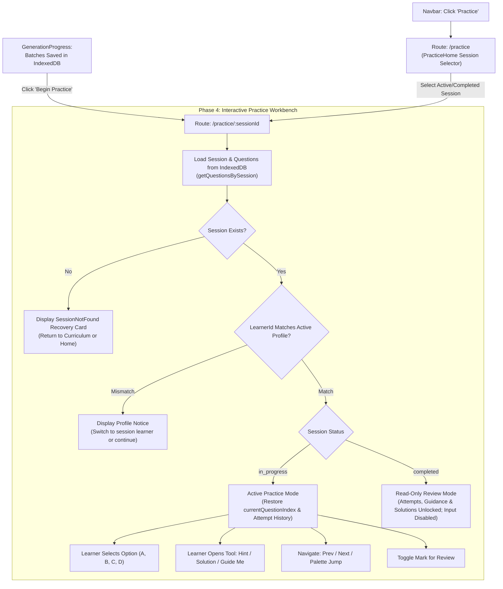

# LearnWell M3 — Phase 4: Interactive Practice Workbench
## Architectural Specification & Phased Implementation Plan (Revision 2.4)

> **Milestone Status:** M1, M2, and M3 Phases 1–3 completed and verified.  
> **Phase 3 Completion Record:** Approved (2026-11-01T09:06:26+05:30, Version 3.4).  
> **Phase 4 Status:** **PLANNING ONLY (REVISED 2.4)** — Strictly zero code or schema changes implemented.

---

## 0. Revision 2.4 Changelog & Design Refinements

In accordance with user review directives, Revision 2.4 incorporates the following precise logical corrections:

1. **Assisted Incorrect Classification (§5.1, §5.3, §6, §6.1, §6.2, §11):**  
   - Corrected attempt classification logic: If a learner inspects any learning tool (Hint, Solution, or Guide Me) prior to submitting an incorrect first attempt, the attempt is classified as `assisted_incorrect` (previously collapsed into `independent_incorrect`).
   - If the first attempt is incorrect without tools, it remains `independent_incorrect`.
   - Added `assisted_incorrect` to the `masteryCategory` TypeScript type union.
   - Preserves immutable `firstAttempt` (`firstAttempt.isAssisted = true`, `firstAttempt.isCorrect = false`).
   - Updated the classification matrix, pseudocode, state walkthroughs, UI status palette descriptions, and test specifications consistently.
2. **Explicit Separation of Manual `retryCount` from Automatic Elimination Entries (§5.1, §5.3, §6.2, §10, §11):**  
   - Explicitly defined `retryCount` as strictly the count of **manual retries** initiated by the learner after the initial manual attempt.
   - Initial manual attempt: `retryCount = 0`.
   - First manual retry: `retryCount = 1`.
   - Second manual retry: `retryCount = 2`.
   - Automatic elimination entries are system deductions and **do not increment `retryCount`** (when automatic elimination appends attempt 4, `retryCount` remains strictly `2`).
   - Prohibited and removed all use of `attempts.length - 1` as a universal formula.
   - Clarified that a **maximum of two manual retries** are possible after the initial attempt before three distractors are eliminated and the remaining option is automatically resolved.
   - Corrected all legacy references that previously described "maximum 3 retries" where manual retries were meant.
   - Preserved strictly sequential `attemptNumber` progression (1, 2, 3, 4) across both manual selections and automatic elimination entries.
3. **Automatic Elimination Invariant Failure Handling (§5.3, §5.4, §11):**  
   - When three distractors are exhausted, the system determines the sole remaining option and strictly verifies that `remainingOptionId === question.correctAnswer`.
   - If verified, the system records `resolutionMethod: 'automatic_elimination'` and locks the question as `assisted_retry_correct`.
   - If the remaining option does not match `question.correctAnswer`, the system flags a critical data-integrity invariant failure.
   - The system **never silently leaves the question in an inconsistent state** and **never persists a falsely resolved answer**.
   - Halts evaluation immediately, cleanly rolls back local state to `previousState`, displays a clear recoverable error toast, and safely releases the transaction lock.
4. **First-Attempt Classification Derivation from Immutable Fields (§5.1, §5.3, §6.2, §11):**  
   - Removed erroneous reference to `attemptState.firstAttempt?.masteryCategory`. Since `firstAttempt` is of type `QuestionAttemptEntry` (which strictly records attempt facts and deliberately does not duplicate `masteryCategory`), retry classification logic derives the preserved category directly from `attemptState.firstAttempt.isAssisted`.
   - When a subsequent manual retry is incorrect, the question's mastery status preserves the initial attempt's classification (`attemptState.firstAttempt?.isAssisted ? 'assisted_incorrect' : 'independent_incorrect'`).
   - When a retry is correct (or deduced by elimination), it transitions to `'assisted_retry_correct'`.

---

### Previous Revision 2.3 Refinements (Maintained)
- **Safe Last-Remaining-Option Resolution via Automatic Elimination:** Automatic deduction when 3 distractors are eliminated with `resolutionMethod: 'automatic_elimination'`.
- **Position-Invariant Test Suite:** Dedicated tests across all four option positions (A, B, C, D).
- **Transaction-Guarded Evaluation Lock:** `isEvaluatingRef.current` held continuously throughout the asynchronous IndexedDB write lifecycle.
- **Rollback Protocol on Persistence Failure:** Clean state restoration on IndexedDB write error.
- **Tri-Action Completion Dialog:** Unanswered, Marked, and Complete pathways.
- **Read-Only Review Mode:** Completed sessions load with pointer-disabled option cards and read-only learning tools.
- **Backup Verification:** Full SHA-256 round-trip durability in `backup.js`.

---

## 1. Existing Project Audit & Codebase Findings

The following audit was verified directly against the actual codebase files in `E:\LearnWell`:

### 1.1 Project Structure & Routing
- **Client Routing ([`client/src/App.jsx`](file:///E:/LearnWell/client/src/App.jsx)):**
  - Existing routes:
    - `/` $\rightarrow$ [`Home.jsx`](file:///E:/LearnWell/client/src/pages/Home.jsx)
    - `/subjects/mathematics` $\rightarrow$ [`MathChapters.jsx`](file:///E:/LearnWell/client/src/pages/MathChapters.jsx)
    - `/subjects/mathematics/:chapterId` $\rightarrow$ [`MathTopics.jsx`](file:///E:/LearnWell/client/src/pages/MathTopics.jsx)
    - `/subjects/mathematics/:chapterId/:topicId` $\rightarrow$ [`FormulaInput.jsx`](file:///E:/LearnWell/client/src/pages/FormulaInput.jsx)
    - `*` $\rightarrow$ [`NotFound.jsx`](file:///E:/LearnWell/client/src/pages/NotFound.jsx)
  - **Status:** Routes `/practice` and `/practice/:sessionId` are not yet mounted. Navigating to `/practice` currently hits the 404 catch-all.
- **Top Navigation ([`client/src/components/Navbar.jsx`](file:///E:/LearnWell/client/src/components/Navbar.jsx)):**
  - Includes a top-level `"Practice"` link pointing to `/practice`.
  - Includes mobile drawer, search overlay, and theme toggle.

### 1.2 Formula Input to Question Generation Flow
- **[`FormulaInput.jsx`](file:///E:/LearnWell/client/src/pages/FormulaInput.jsx):**
  - Operates a 3-stage workflow: `input` $\rightarrow$ `preview` (enforces 1–5 formulas, editable KaTeX list) $\rightarrow$ `confirmed` (saves session to IndexedDB with `status: 'ready_for_generation'`).
  - Clicking *"Generate Practice Questions"* sets stage to `'generating'` and mounts `<GenerationProgress session={confirmedSession} onComplete={...} onCancel={...} />`.
- **[`GenerationProgress.jsx`](file:///E:/LearnWell/client/src/components/GenerationProgress.jsx):**
  - Runs formula-by-formula batch generation via `/api/practice/generate-formula` (6–8 MCQs per formula) and `/api/practice/generate-mixed` (matrix count for $\ge 2$ formulas).
  - Enforces deterministic mathematical validation on every question.
  - Commits validated questions immediately to IndexedDB store `'questions'` via `saveQuestions()`.
  - When all batches finish, it updates the session record (`status: 'in_progress'`, `totalQuestions`, `currentQuestionIndex: 0`) and renders a *"Begin Practice"* button calling `onComplete({ sessionId, totalQuestions })`.
  - **Connection Point:** In Phase 4, `FormulaInput.jsx`'s `onComplete` handler will navigate directly to `/practice/:sessionId`.

### 1.3 Verified IndexedDB Storage Implementation ([`client/src/utils/storage.js`](file:///E:/LearnWell/client/src/utils/storage.js))
- Database: `LearnWellDB` (Version 1).
- Object Stores & Indexes:
  1. `learners` (keyPath: `learnerId`).
  2. `sessions` (keyPath: `sessionId`, indices: `by_learner`, `by_updated`).
  3. `questions` (keyPath: `questionId`, indices: `by_session`, `by_learner`, `by_formula`).
  4. `backups` (keyPath: `backupId`, index: `by_timestamp`).
- **Verified Existing Methods in `storage.js`:**
  - `getSessionsByLearner(learnerId = getActiveLearnerId())`: (Lines 298–312) **Fully implemented.** Queries `sessions` store via index `'by_learner'`, sorts results descending by `updatedAt`, and returns Promise resolving to session records.
  - `getSession(sessionId)`: (Lines 285–293) Retrieves a specific session record.
  - `getQuestionsBySession(sessionId)`: (Lines 408–421) Retrieves questions sorted by `questionNumber`.
  - `updateSession(sessionId, updates)`: (Lines 317–331) Persists session updates atomically.
  - `updateQuestionAttempt(questionId, attemptStateUpdates)`: (Lines 426–457) Persists question attempt state changes.
  - `getActiveLearner()` / `getActiveLearnerId()`: (Lines 121–193) Manages local learner scoping.

---

## 2. Practice User Flow & Entry Architecture



### 2.1 Practice Session Entry Mechanics
1. **Entry via Generation Completion:** Learner clicks *"Begin Practice"* in `GenerationProgress` $\rightarrow$ triggers router navigation to `/practice/:sessionId`.
2. **Entry via Navbar Practice Link (`/practice`):**
   - Renders `PracticeHome.jsx`.
   - Calls verified `getSessionsByLearner(getActiveLearnerId())`.
   - Displays sessions grouped by status:
     - **Active Sessions (`in_progress`):** Progress indicator (e.g. *"14 of 24 completed"*), last active timestamp, and a primary *"Resume Practice"* button.
     - **Completed Sessions (`completed`):** Date completed, total questions, and a *"Review Session"* button.
3. **Missing or Invalid Session Handling:**
   - If `getSession(sessionId)` returns `null`, the workbench renders a dedicated `SessionNotFound` card with clear diagnostic advice and quick links to Mathematics Chapters or Formula Input.
4. **Multi-Learner Scoping:**
   - If `session.learnerId !== getActiveLearnerId()`, a non-intrusive banner informs the user: *"This session belongs to [Learner Name]. Switched active profile to view."*

---

## 3. Practice Screen UI & Responsive Layout Design

```
┌────────────────────────────────────────────────────────────────────────────────────────┐
│ TOP BAR: [← Back to Topic]  Chapter • Topic | Learner: Aarav | Q 4 of 24 [Progress Bar]│
│ CONTEXT: Practicing: Quadratic Formula (f1) [LaTeX]        ⏱️ 01:24   [★ Mark for Review]│
├────────────────────────────────────────────────────────────────────────────────────────┤
│ QUESTION METADATA:  [Intermediate]  [Missing Value]  • Discriminant Parameter          │
│                                                                                        │
│ STATEMENT:                                                                             │
│ If the quadratic equation  3x² - kx + 12 = 0  has two equal real roots,                 │
│ find the positive value of k.                                                          │
│                                                                                        │
│ HINT ACCORDION: (Collapsed / Expandable)                                               │
│                                                                                        │
│ ANSWER OPTIONS:                                                                        │
│ [ A ]  k = 6                      ✗ INCORRECT (Attempt 2)              (Disabled)      │
│ [ B ]  k = 12                     ✓ CORRECT [Elimination Deduced]      (Solved)        │
│ [ C ]  k = 144                    ✗ INCORRECT (Attempt 1)              (Disabled)      │
│        └─ Diagnostic Guidance: 144 is k², not k! Remember to take the square root.     │
│ [ D ]  k = 0                      ✗ INCORRECT (Attempt 3)              (Disabled)      │
├────────────────────────────────────────────────────────────────────────────────────────┤
│ BOTTOM TOOLBAR:                                                                        │
│ [← Prev]  [▦ Question Palette]  │  [💡 Hint]  [🧭 Guide Me]  [📜 Solution]  │  [Next →] │
└────────────────────────────────────────────────────────────────────────────────────────┘
```

### 3.1 Layout Sections
1. **Header & Tracker (`PracticeHeader`):**
   - Breadcrumb navigation (`Mathematics > Chapter > Topic`).
   - Question counter (`"Question 4 of 24"`) with multi-segmented visual progress bar (Answered, Unanswered, Marked for Review).
   - Elapsed timer (records active dwell time per question and total session time).
   - **Mixed Practice Anonymity Enforcement:** If `question.formulaId === 'mixed'`, the formula header displays `"Mixed Practice (Synthesized Formulas)"` with **zero exposure of formula names or formula IDs** (per Section 5.C).
   - Interactive Mark for Review toggle.
2. **Question Card (`QuestionCard`):**
   - Difficulty pill (`Basic` / `Intermediate` / `Advanced`) with standard color-coding.
   - Pattern badge (`Basic Direct`, `Missing Value`, `Variable Rearrangement`, `Conceptual Domain`, etc.).
   - KaTeX math statement renderer supporting mixed natural language and math expressions.
   - 4 accessible option cards (`A`, `B`, `C`, `D`) supporting keyboard shortcuts (`1–4` / `A–D`).
   - Exhausted option strikethrough styling and automatic diagnostic guidance expansion.
   - Elimination resolution badge for deduced answers.
3. **Interactive Learning Drawers & Modals:**
   - **Hint Accordion:** Expandable clue panel above options.
   - **Guide Me Drawer (`GuideMeModal`):** 4-part constructive coaching panel.
   - **Solution Modal (`SolutionModal`):** Complete step-by-step verified derivation.
4. **Bottom Control Toolbar (`PracticeToolbar`):**
   - Previous and Next buttons.
   - Tool activation buttons with visual badge indicating if assistance has been opened.
   - Question Palette drawer trigger.
5. **Question Overview Palette (`QuestionPalette`):**
   - Grid of all questions ($1..N$) showing real-time statuses:
     - ⚪ Neutral: Unanswered.
     - 🟢 Green: Answered Correctly (Independent, Assisted, or Elimination).
     - 🔴 Amber/Red: Answered Incorrectly (Independent Incorrect or Assisted Incorrect).
     - 🟣 Purple Badge / Star: Marked for Review.
     - 🟡 Focus Ring: Current active question.
   - Direct jump to any question by clicking its grid tile.

---

## 4. Learning Tools Triad & Pedagogical Rules

```
┌──────────────────────────────────────────────────────────────────────────┐
│                         LEARNING TOOLS TRIAD                             │
├──────────────────────┬─────────────────────────┬─────────────────────────┤
│ 1. HINT              │ 2. STEP-BY-STEP SOLUTION│ 3. FOUR-PART GUIDE ME   │
├──────────────────────┼─────────────────────────┼─────────────────────────┤
│ - Concise clue       │ - Complete derivation   │ 1. What to Think        │
│ - Points to formula  │ - Authoritative answer  │ 2. How to Approach      │
│   property           │ - Verified calculations │ 3. Remember This        │
│ - Zero direct answer │ - Always accessible     │ 4. Apply Next Time      │
└──────────────────────┴─────────────────────────┴─────────────────────────┘
```

### 4.1 Four-Part Guide Me Structure
The Guide Me modal displays 4 forward-looking pedagogical quadrants:
1. 💡 **What to Think:** Cognitive framing — how to recognize problem pattern and structural triggers.
2. 🧭 **How to Approach:** Actionable step-by-step algorithm to navigate the problem.
3. 📌 **Remember This:** Fundamental identity, theorem condition, or domain constraint (e.g. $\Delta \ge 0$).
4. 🚀 **Apply Next Time:** Generalizable takeaway for similar future examination problems.

*Pedagogical Rule:* Guide Me contains **zero negative or judgmental language** (e.g., no *"You chose B because you didn't read carefully"*).

### 4.2 Automatic Option-Specific Guidance
When an incorrect option is selected, the workbench immediately expands `optionGuidance[selectedOptionId]`. This explains the exact mathematical pitfall of that choice (e.g., *"144 is $k^2$, not $k$. Remember to take the square root to isolate $k$"*). **Because this guidance is revealed automatically, any retry thereafter is pedagogically guided.**

---

## 5. Attempt History & Multi-Attempt Data Model

To resolve single-attempt limitations, the `attemptState` schema is structured as an **Immutable First-Attempt + Sequential Retry History Model**.

### 5.1 Comprehensive `attemptState` TypeScript Schema

```typescript
/**
 * Represents an individual attempt action by the learner or automatic elimination.
 */
interface QuestionAttemptEntry {
  attemptNumber: number;          // 1 for first attempt, 2 for first retry, etc.
  selectedOption: 'A' | 'B' | 'C' | 'D';
  isCorrect: boolean;
  isAssisted: boolean;           // True if ANY tool was viewed OR if attemptNumber > 1
  resolutionMethod: 'manual_selection' | 'automatic_elimination'; // Distinguishes manual click from system deduction
  toolsUsedBeforeAttempt: {
    hint: boolean;
    solution: boolean;
    guideMe: boolean;
    automaticOptionGuidance: boolean; // True for all retries after an incorrect first attempt
  };
  timestamp: string;              // ISO-8601 timestamp
}

/**
 * Complete attempt state stored in IndexedDB for each question.
 */
interface QuestionAttemptState {
  // 1. IMMUTABLE FIRST ATTEMPT RECORD
  // Set once on initial option selection; NEVER overwritten or mutated.
  // Stores fundamental attempt facts (isCorrect, isAssisted). Does NOT store masteryCategory, which is derived at the session state level.
  firstAttempt: QuestionAttemptEntry | null;

  // 2. CHRONOLOGICAL ATTEMPT HISTORY
  // Array of all attempts (attempt 1, attempt 2, etc.) in chronological order.
  attempts: QuestionAttemptEntry[];

  // 3. RETRY TRACKING & PERSISTENCE
  // Strictly tracks number of manual retries after initial manual attempt (0 for initial attempt, 1 for first manual retry, 2 for second manual retry).
  // Automatic elimination entries do NOT increment retryCount. Do not use (attempts.length - 1).
  retryCount: number;
  exhaustedOptions: Array<'A' | 'B' | 'C' | 'D'>; // Distractors already attempted
  isLocked: boolean;              // True once correct option is found or 3 distractors eliminated

  // 4. STANDARDIZED MASTERY CLASSIFICATION
  masteryCategory:
    | 'unattempted'
    | 'independent_correct'
    | 'assisted_correct'
    | 'independent_incorrect'
    | 'assisted_incorrect'
    | 'assisted_retry_correct';

  // 5. BACKWARD-COMPATIBLE SURFACE FIELDS
  // Reflects the latest interaction state for backward compatibility
  selectedOption: 'A' | 'B' | 'C' | 'D' | null;
  isCorrect: boolean | null;
  isAssisted: boolean;

  // 6. TOOL INSPECTION FLAGS
  hintViewed: boolean;
  solutionViewed: boolean;
  guideMeViewed: boolean;
  solutionViewedAfterAnswer: boolean; // Solution inspected after answering correctly/independently

  // 7. WORKFLOW METADATA
  isMarkedForReview: boolean;
  timeSpentSeconds: number;
}
```

### 5.2 Initial State Specification
When a question is generated or reset, `attemptState` is initialized with:
```javascript
{
  firstAttempt: null,
  attempts: [],
  retryCount: 0,
  exhaustedOptions: [],
  isLocked: false,
  masteryCategory: 'unattempted',
  selectedOption: null,
  isCorrect: null,
  isAssisted: false,
  hintViewed: false,
  solutionViewed: false,
  guideMeViewed: false,
  solutionViewedAfterAnswer: false,
  isMarkedForReview: false,
  timeSpentSeconds: 0,
}
```

### 5.3 Immediate-Feedback, Transaction-Lifecycle Lock & Automatic Elimination
- **Immediate Local Evaluation:** Clicking an option card triggers immediate local comparison against `question.correctAnswer`. **No separate "Submit" button is required**, preserving rapid cognitive feedback.
- **Transaction-Guarded Evaluation Lock (`isEvaluatingRef`):**
  - **Activation:** `isEvaluatingRef.current = true` is set synchronously at the very entry of the selection handler (mouse click or keyboard event).
  - **Guard:** If `isEvaluatingRef.current === true` or `attemptState.isLocked === true` or the option is in `exhaustedOptions`, the handler returns immediately without executing.
  - **Lifecycle Binding:** The lock remains held throughout the execution and is released **strictly after the IndexedDB transaction (`updateQuestionAttempt`) has settled**:
    ```javascript
    const handleSelectOption = async (optionId) => {
      if (isEvaluatingRef.current || attemptState.isLocked || isReadOnly) return;
      if (attemptState.exhaustedOptions.includes(optionId)) return;

      isEvaluatingRef.current = true;
      const previousState = { ...attemptState };

      try {
        const isCorrect = optionId === question.correctAnswer;
        const currentAttemptsCount = attemptState.attempts.length;
        const nextAttemptNumber = currentAttemptsCount + 1;
        const isFirst = nextAttemptNumber === 1;

        // Strict retryCount semantic: 0 on first manual attempt; increments by 1 per manual retry.
        // Automatic elimination entries NEVER increment retryCount.
        const nextRetryCount = isFirst ? 0 : attemptState.retryCount + 1;

        // Construct manual selection entry
        const entry = {
          attemptNumber: nextAttemptNumber,
          selectedOption: optionId,
          isCorrect,
          isAssisted: isFirst
            ? (attemptState.hintViewed || attemptState.solutionViewed || attemptState.guideMeViewed)
            : true, // Always assisted on retries due to option guidance
          resolutionMethod: 'manual_selection',
          toolsUsedBeforeAttempt: {
            hint: attemptState.hintViewed,
            solution: attemptState.solutionViewed,
            guideMe: attemptState.guideMeViewed,
            automaticOptionGuidance: !isFirst,
          },
          timestamp: new Date().toISOString(),
        };

        let updatedAttempts = [...attemptState.attempts, entry];
        let nextExhausted = !isCorrect
          ? [...attemptState.exhaustedOptions, optionId]
          : attemptState.exhaustedOptions;

        let finalSelectedOption = optionId;
        let finalIsCorrect = isCorrect;
        let finalIsLocked = isCorrect;
        let finalCategory = isFirst
          ? (isCorrect
              ? (entry.isAssisted ? 'assisted_correct' : 'independent_correct')
              : (entry.isAssisted ? 'assisted_incorrect' : 'independent_incorrect'))
          : (isCorrect
              ? 'assisted_retry_correct'
              : (attemptState.firstAttempt?.isAssisted ? 'assisted_incorrect' : 'independent_incorrect'));

        // Safe Last-Remaining-Option Logic (Automatic Elimination):
        // If 3 distractors are eliminated, the 4th option is deduced with 100% certainty.
        if (!isCorrect && nextExhausted.length === 3) {
          const remainingOptionId = ['A', 'B', 'C', 'D'].find((id) => !nextExhausted.includes(id));

          // Invariant verification: Verify sole remaining option matches independently verified question.correctAnswer
          if (remainingOptionId === question.correctAnswer) {
            const eliminationEntry = {
              attemptNumber: nextAttemptNumber + 1, // Sequential attempt number (e.g. 4)
              selectedOption: remainingOptionId,
              isCorrect: true,
              isAssisted: true,
              resolutionMethod: 'automatic_elimination',
              toolsUsedBeforeAttempt: {
                hint: attemptState.hintViewed,
                solution: attemptState.solutionViewed,
                guideMe: attemptState.guideMeViewed,
                automaticOptionGuidance: true,
              },
              timestamp: new Date().toISOString(),
            };

            updatedAttempts.push(eliminationEntry);
            finalSelectedOption = remainingOptionId;
            finalIsCorrect = true;
            finalIsLocked = true;
            finalCategory = 'assisted_retry_correct';
            // Note: retryCount remains nextRetryCount (2). Automatic elimination entries do NOT increment retryCount!
          } else {
            // Automatic Elimination Invariant Failure: Data integrity violation
            // The remaining option does not match question.correctAnswer.
            // Treat as invariant failure: do NOT persist a falsely resolved answer or leave in an inconsistent state.
            throw new Error(
              `Automatic elimination invariant violation: remaining option '${remainingOptionId}' does not match question.correctAnswer '${question.correctAnswer}'`
            );
          }
        }

        const updatedState = {
          ...attemptState,
          firstAttempt: isFirst ? entry : attemptState.firstAttempt,
          attempts: updatedAttempts,
          retryCount: nextRetryCount,
          exhaustedOptions: nextExhausted,
          isLocked: finalIsLocked,
          selectedOption: finalSelectedOption,
          isCorrect: finalIsCorrect,
          isAssisted: isFirst ? entry.isAssisted : true,
          masteryCategory: finalCategory,
        };

        // 1. Optimistic UI update
        setAttemptState(updatedState);

        // 2. Authoritative IndexedDB persistence
        await updateQuestionAttempt(question.questionId, updatedState);
      } catch (err) {
        // Rollback state on persistence failure or invariant violation
        console.error('Failed to process or persist question attempt:', err);
        setAttemptState(previousState);
        const errorMessage = err.message?.includes('invariant violation')
          ? 'Question data integrity error detected. Your previous state was safely preserved. Please skip this question or contact support.'
          : 'Failed to save your answer to local storage. Please try again.';
        setPersistenceError(errorMessage);
      } finally {
        // Strict release only after transaction completes or fails
        isEvaluatingRef.current = false;
      }
    };
    ```
- **Question Locking upon Success or Elimination:**
  - When an attempt is **Correct** (via manual click or automatic elimination):
    - `isLocked` is set to `true`.
    - All 4 option cards become strictly disabled from mouse clicks and keyboard shortcuts (`1–4`, `A–D`).
    - The correct option renders the green success state. If deduced by elimination, it displays the badge `✓ Correct by Process of Elimination`.
    - Learning tools (Hint, Solution, Guide Me) remain interactive for review.
- **Retry Mechanics upon Incorrect Attempt:**
  - When an attempt is **Incorrect**:
    - The selected distractor is added to `exhaustedOptions` and visually marked with a strikethrough/disabled state.
    - Option-specific guidance expands directly under that distractor.
    - The remaining unselected options remain active.
    - If `exhaustedOptions.length === 3`, automatic elimination immediately resolves the remaining option as described above (subject to invariant verification).

### 5.4 Persistence Failure & Invariant Violation Protocol
- **IndexedDB Write Failure:** If IndexedDB write encounters an unexpected I/O error or quota limit:
  1. The local React state safely rolls back to `previousState`.
  2. A non-intrusive toast alert informs the learner: *"Failed to save your answer to local storage. Please try again."*
  3. `isEvaluatingRef.current` is safely cleared in the `finally` block.
  4. The UI and IndexedDB remain in identical, uncorrupted states, allowing the learner to re-click the option cleanly.
- **Automatic Elimination Invariant Failure:** When 3 distractors are exhausted, if the sole remaining option does not match `question.correctAnswer`:
  1. The system treats this as a critical data-integrity invariant failure.
  2. It immediately halts execution and throws an explicit invariant error.
  3. The system **never silently leaves the question in an inconsistent state** and **never persists a falsely resolved answer**.
  4. Local React state is rolled back cleanly to `previousState` (preserving the state prior to the invalid click).
  5. A recoverable error alert is displayed: *"Question data integrity error detected. Your previous state was safely preserved. Please skip this question or contact support."*
  6. `isEvaluatingRef.current` is safely released in the `finally` block, leaving the user free to navigate or skip without application hang or data loss.

---

## 6. Assistance Classification Rules & Mastery State Transitions

```
┌──────────────────────────────────────────────────────────────────────────┐
│                   ATTEMPT MASTERY CLASSIFICATION MATRIX                  │
├──────────────────────────────────────┬───────────────────────────────────┤
│ 1. Independent Correct               │ Solved on Attempt 1 with NO tools │
│ 2. Assisted Correct                  │ Solved on Attempt 1 WITH tools    │
│ 3. Independent Incorrect             │ Failed on Attempt 1 with NO tools │
│ 4. Assisted Incorrect                │ Failed on Attempt 1 WITH tools    │
│ 5. Assisted Retry Correct            │ Failed Attempt 1, then solved on  │
│                                      │ retry or elimination deduction    │
│ 6. Solution Reviewed After Answer    │ Solved independently, then opened │
│                                      │ Solution (score NOT downgraded)   │
└──────────────────────────────────────┴───────────────────────────────────┘
```

### 6.1 Formal Classification Rules (Cases A through G)

| Case | Trigger Event Sequence | Classification Impact | Record State Result |
| :--- | :--- | :--- | :--- |
| **Rule A** | Learner opens **Hint** before first answer $\rightarrow$ selects correct option | First answer is classified as **Assisted Correct**. | `firstAttempt.isCorrect = true`<br>`firstAttempt.isAssisted = true`<br>`retryCount = 0`<br>`masteryCategory = 'assisted_correct'` |
| **Rule B** | Learner opens **Solution** before first answer $\rightarrow$ selects correct option | First answer is classified as **Assisted Correct**. | `firstAttempt.isCorrect = true`<br>`firstAttempt.isAssisted = true`<br>`retryCount = 0`<br>`masteryCategory = 'assisted_correct'` |
| **Rule C** | Learner opens **Guide Me** before first answer $\rightarrow$ selects correct option | First answer is classified as **Assisted Correct**. | `firstAttempt.isCorrect = true`<br>`firstAttempt.isAssisted = true`<br>`retryCount = 0`<br>`masteryCategory = 'assisted_correct'` |
| **Rule D** | Learner selects correct option independently $\rightarrow$ then opens **Solution** | First answer **retains Independent Correctness**. Solution review recorded separately. | `firstAttempt.isCorrect = true`<br>`firstAttempt.isAssisted = false`<br>`retryCount = 0`<br>`solutionViewedAfterAnswer = true`<br>`masteryCategory = 'independent_correct'` |
| **Rule E** | Learner selects incorrect option independently (no tools) $\rightarrow$ option guidance expands $\rightarrow$ learner retries and selects correct option | First attempt preserved as **Independent Incorrect**. Because option guidance expanded, retry is automatically classified as **Assisted Retry Correct**. | `firstAttempt.isCorrect = false`<br>`firstAttempt.isAssisted = false`<br>`firstAttempt.resolutionMethod = 'manual_selection'`<br>`retryCount = 1`<br>`attempts[1].isCorrect = true`<br>`attempts[1].isAssisted = true`<br>`masteryCategory = 'assisted_retry_correct'` |
| **Rule F** | Learner opens any tool after submitting an answer | **Never retroactively alters** the classification of any already submitted attempt. | Previous `QuestionAttemptEntry` objects in `attempts[]` remain immutable. |
| **Rule G** | Learner opens any tool (**Hint**, **Solution**, or **Guide Me**) before first answer $\rightarrow$ selects incorrect option | First attempt is classified as **Assisted Incorrect**. Subsequent correct retry resolves to **Assisted Retry Correct**. | `firstAttempt.isCorrect = false`<br>`firstAttempt.isAssisted = true`<br>`firstAttempt.resolutionMethod = 'manual_selection'`<br>`retryCount = 0`<br>`masteryCategory = 'assisted_incorrect'` |

### 6.2 Concrete State Transition Walkthroughs

#### Walkthrough 1: Independent Correct with Post-Answer Solution Review (Rule D)
1. **Initial State:** `attempts: []`, `retryCount: 0`, `exhaustedOptions: []`, `hintViewed: false`, `solutionViewed: false`.
2. **Action:** Learner clicks Option B (correct) without opening any tool.
   - Lock acquired (`isEvaluatingRef = true`).
   - `attempt1 = { attemptNumber: 1, selectedOption: 'B', isCorrect: true, isAssisted: false, resolutionMethod: 'manual_selection', toolsUsedBeforeAttempt: { hint: false, solution: false, guideMe: false, automaticOptionGuidance: false }, timestamp: '...' }`
   - `firstAttempt = attempt1`
   - `attempts = [attempt1]`
   - `retryCount = 0` (initial manual attempt: retryCount remains 0)
   - `isLocked = true`
   - `masteryCategory = 'independent_correct'`
   - IndexedDB commit succeeds $\rightarrow$ lock released.
3. **Action:** Learner clicks `[Solution]` to verify their working steps.
   - `solutionViewed = true`
   - `solutionViewedAfterAnswer = true`
   - `firstAttempt` **remains strictly unchanged** (`isAssisted: false`).
   - `masteryCategory` **remains `'independent_correct'`**.

#### Walkthrough 2: Incorrect Initial Attempt Followed by Manual Assisted Retry (Rule E)
1. **Initial State:** `attempts: []`, `retryCount: 0`, `exhaustedOptions: []`, `hintViewed: false`, `guideMeViewed: false`.
2. **Action (Attempt 1 - Initial Manual Attempt):** Learner clicks Option C (incorrect distractor) without opening tools.
   - Lock acquired (`isEvaluatingRef = true`).
   - `attempt1 = { attemptNumber: 1, selectedOption: 'C', isCorrect: false, isAssisted: false, resolutionMethod: 'manual_selection', toolsUsedBeforeAttempt: { hint: false, solution: false, guideMe: false, automaticOptionGuidance: false }, timestamp: '...' }`
   - `firstAttempt = attempt1`
   - `attempts = [attempt1]`
   - `retryCount = 0` (Attempt 1 is initial manual attempt: retryCount remains 0)
   - `exhaustedOptions = ['C']`
   - `masteryCategory = 'independent_incorrect'`
   - Option-specific guidance for Option C expands automatically.
   - IndexedDB commit succeeds $\rightarrow$ lock released.
3. **Action (Attempt 2 - First Manual Retry):** Learner reviews option guidance and clicks Option B (correct option).
   - Lock acquired (`isEvaluatingRef = true`).
   - `attempt2 = { attemptNumber: 2, selectedOption: 'B', isCorrect: true, isAssisted: true, resolutionMethod: 'manual_selection', toolsUsedBeforeAttempt: { hint: false, solution: false, guideMe: false, automaticOptionGuidance: true }, timestamp: '...' }`
   - `attempts = [attempt1, attempt2]`
   - `retryCount = 1` (first manual retry: increments by 1)
   - `firstAttempt` **remains strictly unchanged** (`attemptNumber: 1, isCorrect: false, isAssisted: false`).
   - `isLocked = true`
   - `masteryCategory = 'assisted_retry_correct'`
   - All options lock in green success state.
   - IndexedDB commit succeeds $\rightarrow$ lock released.

#### Walkthrough 2b: Assisted Incorrect Initial Attempt Followed by Manual Retry (Rule G)
1. **Initial State:** `attempts: []`, `retryCount: 0`, `exhaustedOptions: []`, `hintViewed: true` (learner opened Hint).
2. **Action (Attempt 1 - Initial Manual Attempt):** Learner clicks Option C (incorrect distractor) after viewing Hint.
   - Lock acquired (`isEvaluatingRef = true`).
   - `attempt1 = { attemptNumber: 1, selectedOption: 'C', isCorrect: false, isAssisted: true, resolutionMethod: 'manual_selection', toolsUsedBeforeAttempt: { hint: true, solution: false, guideMe: false, automaticOptionGuidance: false }, timestamp: '...' }`
   - `firstAttempt = attempt1`
   - `attempts = [attempt1]`
   - `retryCount = 0` (initial manual attempt: retryCount remains 0)
   - `exhaustedOptions = ['C']`
   - `masteryCategory = 'assisted_incorrect'` (classified as assisted_incorrect because Hint was viewed prior to answering)
   - Option-specific guidance for Option C expands automatically.
   - IndexedDB commit succeeds $\rightarrow$ lock released.
3. **Action (Attempt 2 - First Manual Retry):** Learner reviews option guidance and clicks Option B (correct option).
   - Lock acquired (`isEvaluatingRef = true`).
   - `attempt2 = { attemptNumber: 2, selectedOption: 'B', isCorrect: true, isAssisted: true, resolutionMethod: 'manual_selection', toolsUsedBeforeAttempt: { hint: true, solution: false, guideMe: false, automaticOptionGuidance: true }, timestamp: '...' }`
   - `attempts = [attempt1, attempt2]`
   - `retryCount = 1` (first manual retry: increments by 1)
   - `firstAttempt` **remains strictly unchanged** (`attemptNumber: 1, isCorrect: false, isAssisted: true`).
   - `isLocked = true`
   - `masteryCategory = 'assisted_retry_correct'`
   - All options lock in green success state.
   - IndexedDB commit succeeds $\rightarrow$ lock released.

#### Walkthrough 3: Three Distractors Eliminated Followed by Automatic Elimination Resolution
1. **Initial State:** Correct answer is Option B. `attempts: []`, `retryCount: 0`, `exhaustedOptions: []`.
2. **Action 1 (Attempt 1 - Initial Manual Attempt):** Learner clicks Option C (incorrect).
   - `attempt1 = { attemptNumber: 1, selectedOption: 'C', isCorrect: false, isAssisted: false, resolutionMethod: 'manual_selection', ... }`
   - `firstAttempt = attempt1`
   - `attempts = [attempt1]`
   - `retryCount = 0` (initial manual attempt: retryCount remains 0)
   - `exhaustedOptions = ['C']`
   - `masteryCategory = 'independent_incorrect'`
3. **Action 2 (Attempt 2 - First Manual Retry):** Learner clicks Option A (incorrect).
   - `attempt2 = { attemptNumber: 2, selectedOption: 'A', isCorrect: false, isAssisted: true, resolutionMethod: 'manual_selection', ... }`
   - `attempts = [attempt1, attempt2]`
   - `retryCount = 1` (first manual retry: increments by 1)
   - `exhaustedOptions = ['C', 'A']`
   - `masteryCategory = 'independent_incorrect'` (preserves original first-attempt category derived from immutable `firstAttempt.isAssisted: false`)
4. **Action 3 (Attempt 3 - Second Manual Retry):** Learner clicks Option D (incorrect).
   - `attempt3 = { attemptNumber: 3, selectedOption: 'D', isCorrect: false, isAssisted: true, resolutionMethod: 'manual_selection', ... }`
   - `nextExhausted = ['C', 'A', 'D']` (length = 3)
   - `retryCount = 2` (second manual retry: increments by 1; maximum 2 manual retries reached)
   - `masteryCategory = 'independent_incorrect'` (preserves original first-attempt category derived from immutable `firstAttempt.isAssisted: false`)
   - **System triggers Automatic Elimination:**
     - Identifies sole remaining unselected option: `remainingOptionId = 'B'`.
     - **Invariant Verification:** Checks `remainingOptionId === question.correctAnswer` ('B' === 'B' $\implies$ verified).
     - Appends `attempt4 = { attemptNumber: 4, selectedOption: 'B', isCorrect: true, isAssisted: true, resolutionMethod: 'automatic_elimination', toolsUsedBeforeAttempt: { automaticOptionGuidance: true, ... }, timestamp: '...' }`.
     - `attempts = [attempt1, attempt2, attempt3, attempt4]`.
     - `retryCount = 2` (**Strict Rule:** Automatic elimination is a system deduction, NOT a manual retry. `retryCount` remains strictly `2`. Note: `attempts.length - 1 === 3`, but `retryCount` is strictly 2).
     - `firstAttempt` **remains strictly unchanged** (`attemptNumber: 1, selectedOption: 'C', isCorrect: false, isAssisted: false`).
     - `selectedOption = 'B'`.
     - `isCorrect = true`.
     - `isLocked = true`.
     - `masteryCategory = 'assisted_retry_correct'`.
   - **UI Output:** Options C, A, and D display strikethrough. Option B displays green highlight with `✓ Correct by Process of Elimination` badge. Informative banner explains: *"All 3 distractors eliminated. Option B is correct."* Question locks.

---

## 7. Navigation, Skipping, Reviewing & Session Completion

### 7.1 Non-Blocking Navigation & Question Skipping
- The learner has full autonomy to navigate forward (`Next`), backward (`Previous`), or jump across the set via the Question Palette without answering.
- Unanswered questions are **never blocked**. The learner can leave a question unattempted, continue through the set, and return later.

### 7.2 Mark for Review Behavior
- Clicking the `"Mark for Review"` bookmark button toggles `isMarkedForReview: !current` in `attemptState` and persists immediately to IndexedDB.
- Marked questions display a distinctive purple icon/badge in the `PracticeHeader`, `QuestionPalette`, and progress bar.
- Marking a question for review does not alter its answer or attempt records.

### 7.3 Reaching Question $N$ & Tri-Action Completion Dialog
1. On the final question ($N$), the `"Next"` button label becomes `"Review & Complete Session"`.
2. Clicking this triggers a non-blocking completion evaluation:
   - Calculates total questions $N$, answered questions $A$, unanswered questions $U = N - A$, and marked questions $R$.
3. **Completion Confirmation Modal:**
   - **Scenario A (All Answered, None Marked):** Direct confirmation prompt: *"Ready to complete your practice session?"*
   - **Scenario B (Unanswered or Marked Questions Exist):** Non-blocking tri-action advisory dialog:
     `"You have answered A of N questions (U unanswered, R marked for review). Would you like to review them or complete the session now?"`
     - **Action 1 (`[Review Unanswered (U)]`):** Automatically navigates directly to the first unanswered question (disabled if $U = 0$).
     - **Action 2 (`[Review Marked (R)]`):** Automatically navigates directly to the first marked-for-review question (disabled if $R = 0$).
     - **Action 3 (`[Complete Session Anyway]`):** Commits completion and closes session.
4. **Completion Commitment:**
   - Updates `session.status = 'completed'` and records `session.completedAt = new Date().toISOString()`.
   - Commits to IndexedDB via `updateSession()`.

### 7.4 Completed Session Read-Only Enforcement
When a learner opens a completed session (`session.status === 'completed'`) from `PracticeHome`:
- The workbench enters **Read-Only Review Mode**:
  - A prominent header banner displays: `"Completed Session — Review Mode"`.
  - **Option Card Input Disabled:** All option cards are styled in review state with pointers disabled (`pointer-events: none; cursor: default;`). Keyboard shortcuts (`1–4`, `A–D`) are deactivated.
  - **Attempt History Displayed:** Displays initial attempt, retry attempts, correctness, selected options, and elimination method cleanly.
  - **Tools Read-Only:** Hints, Step-by-Step Solutions, Guide Me, and Option Guidance are interactive for reading, but their open/close triggers **do not fire database updates** (`updateQuestionAttempt`).
  - **Session State Immutability:** `session.status` and `session.completedAt` are protected from accidental mutation.
  - An optional `"Restart Practice"` action allows starting a new session on the same topic if desired.

### 7.5 State Recovery on Browser Refresh / Reopen
- Every navigation call executes:
  `updateSession(sessionId, { currentQuestionIndex: nextIndex })`
- Every option click or tool toggle executes:
  `updateQuestionAttempt(questionId, updatedAttemptState)`
- On page refresh or browser restart:
  - `PracticeSession` reads `session.currentQuestionIndex` from IndexedDB.
  - Reads questions from `getQuestionsBySession(sessionId)`.
  - Restores:
    - Active question index.
    - All previous answer selections and green/red feedback indicators.
    - `exhaustedOptions` array with disabled strikethroughs.
    - Question lock state (`isLocked`).
    - Exact `retryCount`.
    - Complete ordered `attempts[]` array (including any automatic elimination entries) and immutable `firstAttempt`.

---

## 8. Existing Phase 1–3 Compatibility & Backup Proof

### 8.1 Schema Backward Compatibility
The extended `attemptState` model is **100% additive**:
- In Phase 3, questions were saved with initial fields: `selectedOption: null`, `isCorrect: null`, `isAssisted: false`, `hintViewed: false`, etc.
- In Phase 4, when `PracticeSession` loads a question, default fallbacks guarantee seamless operation:
  ```javascript
  const normalizedAttemptState = {
    firstAttempt: question.attemptState?.firstAttempt || null,
    attempts: question.attemptState?.attempts || [],
    retryCount: question.attemptState?.retryCount || 0,
    exhaustedOptions: question.attemptState?.exhaustedOptions || [],
    isLocked: question.attemptState?.isLocked || false,
    masteryCategory: question.attemptState?.masteryCategory || 'unattempted',
    selectedOption: question.attemptState?.selectedOption ?? null,
    isCorrect: question.attemptState?.isCorrect ?? null,
    isAssisted: question.attemptState?.isAssisted || false,
    hintViewed: question.attemptState?.hintViewed || false,
    solutionViewed: question.attemptState?.solutionViewed || false,
    guideMeViewed: question.attemptState?.guideMeViewed || false,
    solutionViewedAfterAnswer: question.attemptState?.solutionViewedAfterAnswer || false,
    isMarkedForReview: question.attemptState?.isMarkedForReview || false,
    timeSpentSeconds: question.attemptState?.timeSpentSeconds || 0,
  };
  ```
- **Zero Database Migration:** Because IndexedDB stores arbitrary JavaScript objects, adding nested properties does not require a database version bump (remains `DB_VERSION = 1`).

### 8.2 Backup & Export Lifecycle Verification ([`client/src/utils/backup.js`](file:///E:/LearnWell/client/src/utils/backup.js))
A rigorous line-by-line inspection of `client/src/utils/backup.js` confirms full round-trip durability for the extended attempt model:

1. **Export Pipeline (`exportData`, lines 201–242):**
   - Fetches questions via `getQuestionsBySession(sessionId)` or `dumpDatabase()`.
   - The question objects, containing the full `attemptState` (with `firstAttempt`, `attempts[]`, `exhaustedOptions`, `resolutionMethod`), are placed directly into the `questions` array of the payload.
2. **Deterministic Cryptographic Checksum (`computeChecksum`, lines 48–71):**
   - Calls `canonicalJsonStringify(contentToHash)`.
   - `canonicalJsonStringify` recursively iterates through all keys at every object depth, sorts keys alphabetically, and stringifies arrays.
   - Computes a SHA-256 hash across the entire payload. All additive attempt fields are deterministically hashed into the checksum.
3. **Schema Validation on Import (`validateBackupSchema`, lines 77–195):**
   - Validates that `version === 1`, `exportedAt` exists, and `checksum` is 64 hex characters.
   - Enforces core question structural invariants: `questionId`, `sessionId`, `statement`, and strictly verifies `options.length === 4` with unique IDs `['A', 'B', 'C', 'D']` and non-empty text.
   - It **does not reject or strip** unknown or additive nested properties inside `attemptState`.
4. **Cryptographic Verification & Atomic Restore (`importData`, lines 276–333):**
   - Recomputes the SHA-256 checksum over the imported payload. If any attempt data is corrupted or forged, import fails with an explicit error.
   - Passes the exact validated `parsed.questions` to `executeAtomicImport()` in `storage.js`.
   - `executeAtomicImport` writes questions via `store.put(q)` into the `questions` store, restoring the complete attempt history without dropping fields.

---

## 9. Proposed Component & File Architecture

```
App.jsx (Mounts /practice and /practice/:sessionId)
├── Navbar.jsx (Existing top navigation)
├── PracticeHome.jsx (NEW - Session selector for /practice)
└── PracticeSession.jsx (NEW - Main Workbench Page Container)
    ├── PracticeHeader.jsx (NEW - Metadata, Tracker, Anonymous Mode, Timer)
    │   └── ProgressBar.jsx (NEW - Segmented visual progress bar)
    ├── QuestionCard.jsx (NEW - Math Statement, Options, Feedback, Guidance)
    │   ├── MathText.jsx (NEW - Parser rendering KaTeX math inside sentences)
    │   └── OptionCard.jsx (NEW - Interactive card with shortcut & state styling)
    ├── PracticeToolbar.jsx (NEW - Prev/Next, Review toggle, Tool buttons, Palette trigger)
    ├── GuideMeModal.jsx (NEW - 4-part constructive coaching drawer)
    ├── SolutionModal.jsx (NEW - Step-by-step verified solution modal)
    ├── QuestionPalette.jsx (NEW - Grid navigation drawer with status badges)
    └── SessionCompletionModal.jsx (NEW - Tri-action completion prompt)
```

### 9.1 Exact File Responsibilities

| Component / File | File Path | Scope & Responsibility | Status |
| :--- | :--- | :--- | :---: |
| **`PracticeSession.jsx`** | `client/src/pages/PracticeSession.jsx` | Top-level state coordinator: loads session/questions from IndexedDB, coordinates active index, handles keyboard shortcuts (`1–4`, `A–D`), enforces review-mode read-only protection, manages transaction-guarded lock (`isEvaluatingRef`), orchestrates attempt state persistence. | **New** |
| **`PracticeSession.css`** | `client/src/pages/PracticeSession.css` | Workbench styles, layout grid, transitions, Dark/Light theme CSS variables. | **New** |
| **`PracticeHome.jsx`** | `client/src/pages/PracticeHome.jsx` | Displays active and completed sessions via verified `getSessionsByLearner()`, allowing one-click resume. | **New** |
| **`PracticeHome.css`** | `client/src/pages/PracticeHome.css` | Styles for session history cards, progress pills, and empty states. | **New** |
| **`PracticeHeader.jsx`** | `client/src/components/PracticeHeader.jsx` | Renders session metadata, question tracker, timer, formula context (with mixed practice anonymity enforcement). | **New** |
| **`QuestionCard.jsx`** | `client/src/components/QuestionCard.jsx` | Renders difficulty badge, pattern tag, statement, 4 option cards, option exhaustion strikethrough, automatic elimination badge, locking upon success, and automatic option guidance. | **New** |
| **`MathText.jsx`** | `client/src/components/MathText.jsx` | Splits sentences with embedded LaTeX (`$...$`, `\(...\)`) and renders KaTeX cleanly alongside text. | **New** |
| **`PracticeToolbar.jsx`** | `client/src/components/PracticeToolbar.jsx` | Bottom action bar housing Prev, Next, Mark for Review, Hint, Solution, and Guide Me buttons. | **New** |
| **`GuideMeModal.jsx`** | `client/src/components/GuideMeModal.jsx` | 4-part constructive coaching drawer (What to Think, How to Approach, Remember This, Apply Next Time). | **New** |
| **`SolutionModal.jsx`** | `client/src/components/SolutionModal.jsx` | Step-by-step mathematical reasoning modal with final verified answer. | **New** |
| **`QuestionPalette.jsx`** | `client/src/components/QuestionPalette.jsx` | Slide-out grid navigation drawer allowing one-click jumping to any question $1..N$. | **New** |
| **`SessionCompletionModal.jsx`** | `client/src/components/SessionCompletionModal.jsx` | Tri-action completion confirmation prompt offering separate pathways for Unanswered, Marked, and Complete Anyway. | **New** |
| **`App.jsx`** | `client/src/App.jsx` | Mounts `/practice` and `/practice/:sessionId` routes. | **Modify** |
| **`FormulaInput.jsx`** | `client/src/pages/FormulaInput.jsx` | Connects `GenerationProgress` `onComplete` callback to navigate to `/practice/:sessionId`. | **Modify** |
| **`storage.js`** | `client/src/utils/storage.js` | Unchanged; existing `getSessionsByLearner` and `updateQuestionAttempt` fully support all needs. | **Retain** |

---

## 10. Phased Implementation Roadmap

Phase 4 implementation is partitioned into 4 manageable, sequential sub-phases:

```
┌─────────────────────────────────────────────────────────────────────────────┐
│                       PHASE 4 IMPLEMENTATION ROADMAP                        │
├─────────────────┬───────────────────────────────────────────────────────────┤
│ Sub-Phase 4.1   │ Routing, Session Retrieval & Core Practice Layout         │
│ Sub-Phase 4.2   │ Question Rendering, KaTeX Parser & Multi-Attempt Engine   │
│ Sub-Phase 4.3   │ Learning Tools Triad (Hint, Solution, Guide Me Drawer)    │
│ Sub-Phase 4.4   │ Palette Navigation, Review State, Completion & Durability │
└─────────────────┴───────────────────────────────────────────────────────────┘
```

### Sub-Phase 4.1: Routing, Session Retrieval & Core Practice Layout
- **Objective:** Establish `/practice` and `/practice/:sessionId` routes, implement `PracticeHome` using verified `getSessionsByLearner()`, scaffold `PracticeSession` container, and connect `FormulaInput` navigation.
- **Files Involved:**
  - `client/src/App.jsx` (mount routes)
  - `client/src/pages/PracticeHome.jsx` & `PracticeHome.css`
  - `client/src/pages/PracticeSession.jsx` & `PracticeSession.css`
  - `client/src/components/PracticeHeader.jsx`
  - `client/src/pages/FormulaInput.jsx` (connect `onComplete`)
- **Data Flow:** Route param `sessionId` $\rightarrow$ `getSession(sessionId)` + `getQuestionsBySession(sessionId)` $\rightarrow$ initializes state.
- **Acceptance Criteria:**
  - Navigating to `/practice` lists active sessions for the active learner.
  - Clicking "Begin Practice" in `GenerationProgress` navigates directly into `/practice/:sessionId`.
  - Invalid session IDs display the clean `SessionNotFound` recovery card.
- **Testing:** Verify route resolution, session loading, missing session fallback, and active learner scoping.

### Sub-Phase 4.2: Question Rendering, KaTeX Parser & Multi-Attempt Engine
- **Objective:** Build `MathText.jsx` for mixed math parsing, render `QuestionCard` with 4 options, implement immediate feedback, transaction-guarded lock (`isEvaluatingRef`), question locking, immutable `firstAttempt`, strict `retryCount` semantics (0 on attempt 1, incrementing by 1 per manual retry; automatic elimination does not increment `retryCount`), `assisted_incorrect` and `independent_incorrect` classifications, automatic elimination resolution with invariant verification when 3 distractors are eliminated, rollback on persistence or invariant error, and retry tracking.
- **Files Involved:**
  - `client/src/components/MathText.jsx`
  - `client/src/components/QuestionCard.jsx`
  - `client/src/pages/PracticeSession.jsx` (wire selection, locking, rollback, invariant verification, automatic elimination, and retry handlers)
- **Data Flow:** Learner clicks option $\rightarrow$ transaction lock acquired (`isEvaluatingRef = true`) $\rightarrow$ local check against `correctAnswer` $\rightarrow$ generates `QuestionAttemptEntry` with `resolutionMethod: 'manual_selection'` $\rightarrow$ sets immutable `firstAttempt` on attempt 1 (evaluating `assisted_correct`, `independent_correct`, `assisted_incorrect`, or `independent_incorrect`) $\rightarrow$ if 3 distractors eliminated, verifies `remainingOptionId === question.correctAnswer` and appends `resolutionMethod: 'automatic_elimination'` entry for remaining option (or raises invariant failure on mismatch) $\rightarrow$ locks question on correct answer $\rightarrow$ persists via `updateQuestionAttempt()` $\rightarrow$ lock released in `finally` block.
- **Acceptance Criteria:**
  - KaTeX renders inline math in question statements and option cards without layout breakage.
  - Keyboard shortcuts (`1–4` / `A–D`) select options.
  - First attempt is recorded as immutable with `retryCount = 0`.
  - First attempt is classified as `assisted_incorrect` if tools were viewed prior to an incorrect answer, or `independent_incorrect` if no tools were viewed.
  - Manual retries increment `retryCount` by 1 per manual retry (maximum 2 manual retries).
  - If 3 distractors are exhausted, the remaining option is verified against `question.correctAnswer`; if matched, it is automatically resolved as correct with `resolutionMethod: 'automatic_elimination'` and highlighted green with `✓ Correct by Process of Elimination` badge.
  - Automatic elimination entries do NOT increment `retryCount` (`retryCount` remains 2).
  - If the remaining option does not match `question.correctAnswer`, an invariant failure is raised, evaluation halts, local state rolls back safely to `previousState`, and a recoverable error is displayed.
  - Answering correctly locks all option cards from further input.
  - Distractors attempted are added to `exhaustedOptions` with strikethrough.
  - Rapid double-clicks or concurrent keypresses while persistence is in-flight are rejected.
  - Persistence failure rolls back state safely without corrupting attempt order.
  - Zero Gemini API calls made.
- **Testing:** Unit test math parsing, option selection events, first attempt immutability, `assisted_incorrect` classification, `retryCount` progression across manual attempts, invariant verification and automatic elimination across all 4 option positions, question locking, transaction lock behavior, and rollback on simulated write failure or invariant failure.

### Sub-Phase 4.3: Learning Tools Triad (Hint, Solution, Guide Me Drawer)
- **Objective:** Implement Hint accordion, Solution modal, and Guide Me 4-part drawer with strict assistance state tracking and automatic retry assistance rules.
- **Files Involved:**
  - `client/src/components/GuideMeModal.jsx`
  - `client/src/components/SolutionModal.jsx`
  - `client/src/components/PracticeToolbar.jsx`
  - `client/src/pages/PracticeSession.jsx`
- **Data Flow:** Learner clicks Hint/Solution/Guide Me $\rightarrow$ opens modal/drawer $\rightarrow$ updates `attemptState` in IndexedDB (`hintViewed`, `solutionViewed`, `guideMeViewed`).
- **Acceptance Criteria:**
  - Guide Me drawer renders all 4 parts (*What to Think*, *How to Approach*, *Remember This*, *Apply Next Time*).
  - Opening tools before answering marks `firstAttempt.isAssisted: true` (Rules A, B, C).
  - Opening Solution after independent correct answer preserves independent score and sets `solutionViewedAfterAnswer: true` (Rule D).
  - Retrying after an incorrect answer automatically sets `attemptN.isAssisted: true` due to automatic option guidance (Rule E).
- **Testing:** Verify assistance flag logic, automatic retry assistance, modal keyboard accessibility (Escape to close), and attempt record persistence.

### Sub-Phase 4.4: Palette Navigation, Review State, Completion & Durability
- **Objective:** Implement Previous/Next navigation, Question Palette jump drawer, Mark for Review toggle, tri-action session completion prompt, read-only mode for completed sessions, and reload durability.
- **Files Involved:**
  - `client/src/components/QuestionPalette.jsx`
  - `client/src/components/SessionCompletionModal.jsx`
  - `client/src/components/PracticeToolbar.jsx`
  - `client/src/pages/PracticeSession.jsx`
- **Data Flow:** Navigating updates `session.currentQuestionIndex` in IndexedDB. Reaching question $N$ triggers completion dialog $\rightarrow$ marks `session.status = 'completed'`.
- **Acceptance Criteria:**
  - Palette displays grid of all questions with accurate status colors (Unanswered, Correct, Incorrect, Marked for Review, Active).
  - Clicking any palette tile jumps directly to that question.
  - Unanswered questions can be freely skipped without blocking.
  - Tri-action completion dialog provides dedicated pathways for Unanswered questions, Marked questions, and Complete Anyway.
  - Completed sessions open in Read-Only Review Mode with option inputs strictly disabled.
  - Refreshing the browser on question $K$ restores question $K$ with all attempt history, lock states, and exhausted options intact.
- **Testing:** State preservation across jumps, browser reload test, tri-action completion dialog flow, read-only mode verification, mobile and desktop responsive tests, Dark and Light theme verification.

---

## 11. Comprehensive Testing Strategy

An automated test suite will verify all Phase 4 specifications before seeking approval:

1. **Option Selection & Immediate Feedback:**
   - Verify selecting correct option evaluates immediately as `isCorrect: true`, displays green styling, and locks option inputs.
   - Verify selecting incorrect option evaluates as `isCorrect: false`, displays amber/red styling, and expands option guidance.
2. **First Attempt Immutability, `assisted_incorrect` Classification & `retryCount` Progression:**
   - **Initial State:** Verify `retryCount === 0` and `firstAttempt === null`.
   - **Independent Incorrect:** When Option C (incorrect) is selected first without tools, verify `firstAttempt.selectedOption === 'C'`, `firstAttempt.isCorrect === false`, `firstAttempt.isAssisted === false`, `masteryCategory === 'independent_incorrect'`, and `retryCount === 0`.
   - **Assisted Incorrect:** When Option C (incorrect) is selected first after inspecting Hint, Solution, or Guide Me, verify `firstAttempt.selectedOption === 'C'`, `firstAttempt.isCorrect === false`, `firstAttempt.isAssisted === true`, `masteryCategory === 'assisted_incorrect'`, and `retryCount === 0`.
   - **First Manual Retry (Incorrect):** When Option A (incorrect) is selected on attempt 2, verify `retryCount === 1`, while `firstAttempt` remains strictly unchanged (`attemptNumber: 1`). Verify `masteryCategory` preserves the initial category derived from immutable `firstAttempt` fields (`firstAttempt.isAssisted ? 'assisted_incorrect' : 'independent_incorrect'`).
   - **Second Manual Retry (Incorrect):** When Option D (incorrect) is selected on attempt 3, verify `retryCount === 2` and `masteryCategory` remains preserved as the initial category.
   - **Automatic Elimination Entry:** When Option D elimination triggers automatic deduction of Option B (attempt 4), verify `attempts.length === 4`, `attempts[3].attemptNumber === 4`, `attempts[3].resolutionMethod === 'automatic_elimination'`, `masteryCategory === 'assisted_retry_correct'`, and `retryCount` remains strictly `2` (verify `retryCount !== attempts.length - 1`).
3. **Automatic Elimination Resolution across All 4 Answer Positions & Invariant Verification:**
   - **Position A Correct (Distractors: B, C, D):** Select B (incorrect) $\rightarrow$ select C (incorrect) $\rightarrow$ select D (incorrect) $\implies$ verify system verifies `remainingOptionId === question.correctAnswer` and automatically resolves Option A as correct with `resolutionMethod: 'automatic_elimination'`, `selectedOption === 'A'`, `isCorrect: true`, `isLocked === true`, and `masteryCategory === 'assisted_retry_correct'`.
   - **Position B Correct (Distractors: A, C, D):** Select A $\rightarrow$ select C $\rightarrow$ select D $\implies$ verify automatic elimination verifies and resolves Option B as correct with `resolutionMethod: 'automatic_elimination'`.
   - **Position C Correct (Distractors: A, B, D):** Select A $\rightarrow$ select B $\rightarrow$ select D $\implies$ verify automatic elimination verifies and resolves Option C as correct with `resolutionMethod: 'automatic_elimination'`.
   - **Position D Correct (Distractors: A, B, C):** Select A $\rightarrow$ select B $\rightarrow$ select C $\implies$ verify automatic elimination verifies and resolves Option D as correct with `resolutionMethod: 'automatic_elimination'`.
   - **Distinction Verification:** Verify that `attempts[3].resolutionMethod === 'automatic_elimination'`, while `attempts[0..2].resolutionMethod === 'manual_selection'`.
   - **Automatic Elimination Invariant Failure Handling:** Simulate a corrupted question where 3 distractors are eliminated but the sole remaining option does not match `question.correctAnswer`. Verify the invariant check halts execution, aborts automatic resolution, does not mutate or persist false attempt records, cleanly rolls back local state to `previousState`, displays a recoverable error notification, and releases `isEvaluatingRef.current`.
4. **Assistance Classification Suite (Rules A–G):**
   - **Rule A:** Hint viewed prior to answer $\implies$ `firstAttempt.isAssisted: true` (`assisted_correct`).
   - **Rule B:** Solution viewed prior to answer $\implies$ `firstAttempt.isAssisted: true` (`assisted_correct`).
   - **Rule C:** Guide Me viewed prior to answer $\implies$ `firstAttempt.isAssisted: true` (`assisted_correct`).
   - **Rule D:** Solution viewed *after* independent correct answer $\implies$ `firstAttempt.isAssisted: false`, `solutionViewedAfterAnswer: true`, `masteryCategory: 'independent_correct'`.
   - **Rule E:** Incorrect attempt with no tools $\rightarrow$ automatic guidance $\rightarrow$ correct retry $\implies$ `masteryCategory: 'assisted_retry_correct'`.
   - **Rule F:** Opening a tool after an attempt never retroactively mutates prior `attempts[]` entries.
   - **Rule G:** Hint, Solution, or Guide Me viewed prior to incorrect first answer $\implies$ `firstAttempt.isAssisted: true`, `masteryCategory: 'assisted_incorrect'`.
5. **Transaction-Lifecycle Lock & Concurrent Click Rejection:**
   - Verify that while an IndexedDB write is in progress, any subsequent option click or keypress is rejected.
   - Verify that the lock is released strictly after the write transaction settles.
   - Verify that simulating a database write failure rolls back the local state without corrupting `attempts[]`.
6. **Question Locking & Option Strikethrough:**
   - Verify that answering correctly sets `isLocked = true` and rejects any further clicks on options.
   - Verify that attempted distractors are added to `exhaustedOptions` and cannot be clicked again.
   - Verify maximum 2 manual retries after initial manual attempt (totaling at most 4 attempt entries across 4 options when automatic elimination resolves the sole remaining option).
7. **Tri-Action Completion Dialog:**
   - Verify that clicking "Review & Complete" with unanswered questions displays `[Review Unanswered]`, `[Review Marked]`, and `[Complete Session Anyway]`.
   - Verify that clicking `[Review Unanswered]` navigates directly to the first unattempted question.
   - Verify that clicking `[Review Marked]` navigates directly to the first question marked for review.
8. **Read-Only Mode for Completed Sessions:**
   - Verify that opening a completed session disables option clicks, ignores keyboard shortcuts (`1–4`), unlocks learning tools in read-only mode, and prevents mutations to `session.status`.
9. **Browser Reload & Refresh Durability:**
   - Verify that reloading the browser on Question 5 of 24 restores Question 5 with all answers, attempt history, lock states, and exhausted options intact.
10. **Learner Scoping & Session Retrieval:**
    - Verify `getSessionsByLearner(learnerId)` retrieves only sessions belonging to that learner.
    - Verify missing session IDs cleanly display `SessionNotFound` without app crash.
11. **Backup Export/Import Round-Trip:**
    - Verify that exporting data via `exportData()` includes the extended `attemptState` and computes a valid SHA-256 checksum.
    - Verify that importing the JSON via `importData()` passes `validateBackupSchema()`, passes checksum verification, and restores all attempt records intact into IndexedDB.
12. **Mixed Practice Anonymity Rule:**
    - Verify that questions with `formulaId === 'mixed'` do not display formula names, IDs, or hints in headers or statements.
13. **Zero Gemini API Calls Guarantee:**
    - Verify that zero network requests to `/api/practice/*` or Gemini occur during the entire practice session.
14. **Code Standards & Visual Quality:**
    - `oxlint` passes with 0 errors and 0 warnings.
    - `vite build` builds cleanly for production.
    - Dark and Light themes render cleanly across mobile ($375\text{px}$) and desktop ($1200\text{px}$).

---

## 12. Out-of-Scope Features & Risk Analysis

### Out-of-Scope (Deferred to Phase 5 or Milestone 4)
- **Phase 5 Analytics Dashboard (`PracticeSummary.jsx`):** Post-session accuracy breakdowns, formula-by-formula mastery graphs, and JSON backup export buttons belong exclusively to Phase 5.
- **Audio / Voice Guidance:** Voice playback of hints or statements is deferred to future milestones.
- **Cloud Synchronization / Remote Databases:** LearnWell remains strictly local and offline-first; no Firebase, Supabase, or cloud database is permitted.
- **User Authentication / Passwords:** Multi-learner scoping remains a lightweight local profile convenience without passwords.

### Risks & Mitigations
1. **Risk:** KaTeX rendering failure on complex LaTeX strings inside question statements.  
   *Mitigation:* Create `MathText.jsx` with safe regex tokenization and fallback to styled plain text, ensuring zero unhandled crashes.
2. **Risk:** Accidental double-submission or state race condition during fast interaction.  
   *Mitigation:* Use strict transaction-lifecycle locking (`isEvaluatingRef`) covering the entire asynchronous IndexedDB operation with safe rollback on error.
3. **Risk:** Accidental modification of completed sessions during review.  
   *Mitigation:* Explicit `isReadOnly` flag derived from `session.status === 'completed'` that bypasses write handlers and deactivates option click bindings.

---

## 13. Verification & Next Steps

This revised plan provides a complete, self-contained architecture for Phase 4 addressing all review feedback while strictly maintaining Phase 1–3 stability.

**Status:** Awaiting user review and explicit approval before starting Sub-Phase 4.1 implementation.
